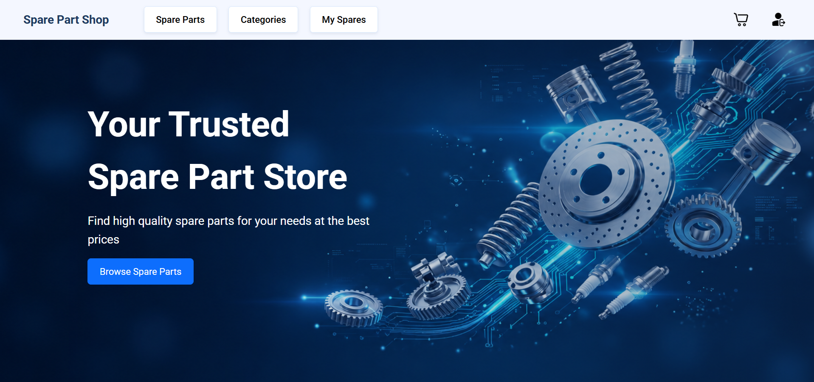
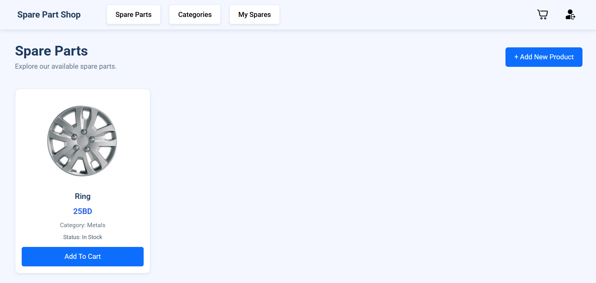
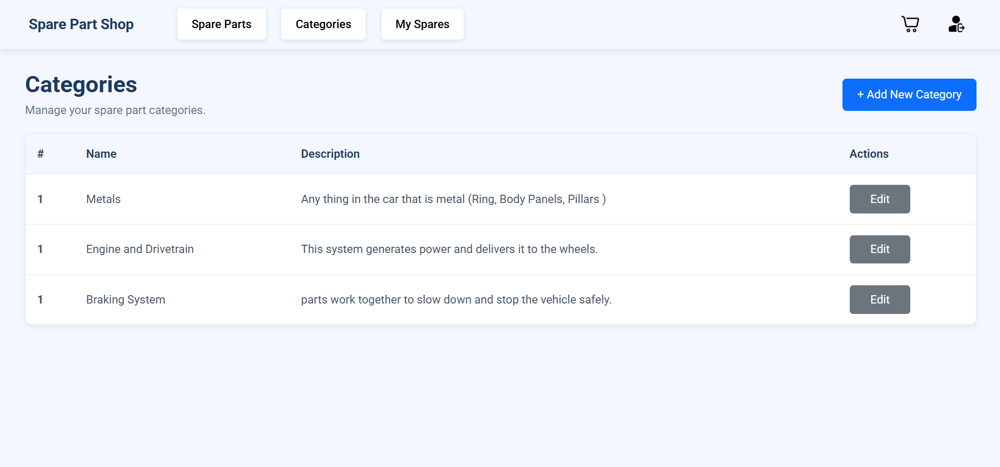

# Spare Part Management

## Overview

**Spare Part Management** is a full-stack web application built using the MEN stack designed to streamline the retail and management of automotive spare parts. The application features role-based access control (RBAC) tailored for **Admins**, **Garages**, and **Customers**, allowing for secure authentication, inventory tracking, category management, and shopping cart operations—all enhanced with responsive Bootstrap components and asynchronous Toast notifications.

---

## Screenshots

### 1. Login Page


### 2. Homepage



### 3. Product List



### 4. Category List



---

## Technologies Used

- **Runtime:** Node.js
- **Framework:** Express.js
- **Database & ODM:** MongoDB, Mongoose (`connect-mongo` for session storage)
- **Templating Engine:** EJS (Embedded JavaScript Templates)
- **Styling & UI:** Bootstrap, Animate.css, Toastify-js
- **Authentication & Security:** bcrypt, express-session
- **File Uploads & Utilities:** multer, method-override, dotenv, morgan

---

## User Stories

### General Users & Authentication

- As a user, I want to be able to sign up to the system.
- As a user, I want to be able to log in to the system.
- As a user, I want to be able to log out of the system.
- As a user, I want to be able to see the welcome page (homepage) upon login.
- As a user, I want to see a toast notification on any action taken.

### Product & Cart Management

- As a user, I want to see a list of all products.
- As a user, I want to add a product.
- As a user, I want to edit a product.
- As a user, I want to delete a product.
- As a user, I want to see a list of my products.
- As a user, I want to add products to my cart.
- As a user, I want to delete products from my cart.

### Admin Privileges

- As an admin, I want to be able to add categories.
- As an admin, I want to be able to edit categories.

## Database Design

The application uses MongoDB with Mongoose ODM, structuring data around four main schemas with relational references (`ObjectId` mappings).

### 1. User Schema

Manages user authentication, profile states, and Role-Based Access Control (RBAC).

- **`username`**: String (Required, Unique, Trimmed)
- **`password`**: String (Required, hashed with bcrypt)
- **`role`**: String (Enum: `["admin", "garage", "customer"]`, Default: `"user"`)
- **`isDeleted`**: Boolean (Default: `false`)
- **Timestamps**: `createdAt`, `updatedAt`

### 2. Category Schema

Organizes inventory categories (restricted to admin management).

- **`name`**: String (Required, Unique, Min: 3, Max: 15 chars)
- **`description`**: String (Min: 7, Max: 30 chars)
- **Timestamps**: `createdAt`, `updatedAt`

### 3. Product Schema

Stores spare part details, pricing, status, and establishes relationships to both the owner and category.

- **`name`**: String (Required, Min: 3, Max: 30 chars)
- **`price`**: Number (Required, Min: 0)
- **`imageUrl`**: String (Required)
- **`status`**: String (Enum: `["In Stock", "Out of Stock"]`, Default: `"In Stock"`)
- **`owner`**: ObjectId (Ref: `"User"`, Required)
- **`categoryId`**: ObjectId (Ref: `"Category"`, Required)
- **Timestamps**: `createdAt`, `updatedAt`

### 4. Cart Schema

Manages individual shopping carts linked to specific users.

- **`cartProducts`**: Array of ObjectIds (Ref: `"Product"`)
- **`owner`**: ObjectId (Ref: `"User"`, Required)
- **Timestamps**: `createdAt`, `updatedAt`

## Getting Started

Follow these instructions to get a copy of the project up and running on your local machine for development and testing purposes.

### Prerequisites

Make sure you have the following installed on your machine:

- [Node.js](https://nodejs.org/) (v18 or higher recommended)
- [MongoDB](https://www.mongodb.com/) (running locally or a connection string from MongoDB Atlas)

### Installation & Setup

1. **Clone the repository:**

   ```bash
   git clone https://github.com/HSN-Gallaf/spare-parts-management.git
   cd spare-part-management
   npm install
   ```

2. **Configure environment variables:**
   Create a `.env` file in the root directory and add the following variables:

   ```env
   PORT=3000
   MONGODB_URI=your_mongodb_connection_string_here
   SESSION_SECRET=your_super_secret_key_here
   ```

3. **Start the server:**

   ```bash
   nodemon server.js
   ```

4. **Access the application:**
   Open your browser and navigate to `http://localhost:3000`.

## Routes

The application's backend routing is organized into modular Express routers handling authentication, shopping cart management, category administration, homepage views, and product management.

### 1. Authentication Routes (`auth.js` / `/auth`)

| Method | Route       | Description                                                                                     |
| :----- | :---------- | :---------------------------------------------------------------------------------------------- |
| `GET`  | `/sign-up`  | Renders the user registration form with available roles                                         |
| `POST` | `/sign-up`  | Processes user registration, hashes password, creates a shopping cart, and redirects to sign-in |
| `GET`  | `/sign-in`  | Renders the user login form                                                                     |
| `POST` | `/sign-in`  | Authenticates user credentials, sets up session, and redirects to home                          |
| `GET`  | `/sign-out` | Destroys the user session and redirects to home                                                 |

---

### 2. Cart Routes (`cart.js` / `/cart`)

| Method   | Route                     | Description                                       |
| :------- | :------------------------ | :------------------------------------------------ |
| `GET`    | `/`                       | Views the signed-in user's shopping cart products |
| `POST`   | `/:productId/add-to-cart` | Adds a specific product to the user's cart        |
| `DELETE` | `/:productId`             | Removes a specific product from the user's cart   |

---

### 3. Category Routes (`category.js` / `/categories`)

_Note: All category routes require authentication and Admin privileges (`isSignedIn`, `isAdmin`)._

| Method   | Route          | Description                                   |
| :------- | :------------- | :-------------------------------------------- |
| `POST`   | `/`            | Creates a new inventory category              |
| `GET`    | `/`            | Lists all categories                          |
| `DELETE` | `/:categoryId` | Deletes a category by ID                      |
| `GET`    | `/:categoryId` | Renders the edit form for a specific category |
| `PUT`    | `/:categoryId` | Updates category details                      |

---

### 4. Index / Home Routes (`index.js` / `/`)

| Method | Route | Description                         |
| :----- | :---- | :---------------------------------- |
| `GET`  | `/`   | Renders the welcome / homepage view |

---

### 5. Product Routes (`product.js` / `/products`)

| Method   | Route          | Description                                                                          |
| :------- | :------------- | :----------------------------------------------------------------------------------- |
| `POST`   | `/`            | Creates a new product with image upload (`isSignedIn`, `isGarageOrAdmin`)            |
| `GET`    | `/`            | Lists all available products and categories (`isSignedIn`)                           |
| `GET`    | `/my-products` | Lists products owned by the logged-in garage/admin (`isSignedIn`, `isGarageOrAdmin`) |
| `GET`    | `/:productId`  | Renders the edit form for a specific product (`isSignedIn`, `isGarageOrAdmin`)       |
| `PUT`    | `/:productId`  | Updates a product's details and optional new image (`isSignedIn`, `isGarageOrAdmin`) |
| `DELETE` | `/:productId`  | Deletes a product from the database (`isSignedIn`, `isGarageOrAdmin`)                |

## Features

### Role-Based Access Control (RBAC)

- **Admin:** Full access to manage product categories, along with universal viewing capabilities.
- **Garage:** Can add, edit, and delete their own spare part listings and manage inventory, while restricted from category management.
- **Customer:** Streamlined experience focused on browsing available spare parts and managing personal shopping carts.

### Secure Authentication & Session Management

- Secure user sign-up and login utilizing **bcrypt** for cryptographic password hashing.
- Persistent session management backed by **Express Session** and **MongoDB** (`connect-mongo`).

### Dynamic Inventory & Product Management

- Comprehensive product listing with filters, price controls, and inventory status (`In Stock` / `Out of Stock`).
- Image upload handling via **Multer** to attach part images directly to product profiles.
- Dedicated dashboard view for garages/admins to track and manage their uploaded products.

### Interactive Shopping Cart

- Add products to a user-specific shopping cart with duplicate prevention checks.
- Real-time cart overview displaying populated product details and easy item removal.

### User Experience Enhancements

- Asynchronous notifications powered by **Toastify-js** to give instant feedback on user actions.
- Responsive layouts designed with **Bootstrap** and enhanced with **Animate.css** transitions.

## Future Enhancements

1. **Robust Category Deletion & Referential Integrity:** Implement cascading deletes or soft-delete mechanisms so that deleting a category properly handles or reassigns associated products, preventing broken object references in the database.
2. **Secure Admin Provisioning:** Remove direct admin registration from the public sign-up page. Introduce a secure seeding script, environment secret key, or an admin-exclusive invitation dashboard to manage privileged roles safely.
3. **Cloud-Based Image Storage:** Migrate file uploads from local project storage (`public/products`) to a cloud-based storage provider like Cloudinary or AWS S3 to optimize server performance and prevent local storage bloat over time.

## Credits

- **File Uploads:** [Multer](https://www.npmjs.com/package/multer) for handling multipart/form-data for product image uploads.
- **Icons & Styling:** [Bootstrap](https://getbootstrap.com/docs/5.3) for responsive UI components and layout structure.
- **Animations:** [Animate.css](https://animate.style/) for smooth, ready-to-use CSS animations.
- **Notifications:** [Toastify-js](https://apvarun.github.io/toastify-js/) for lightweight asynchronous toast alerts.
